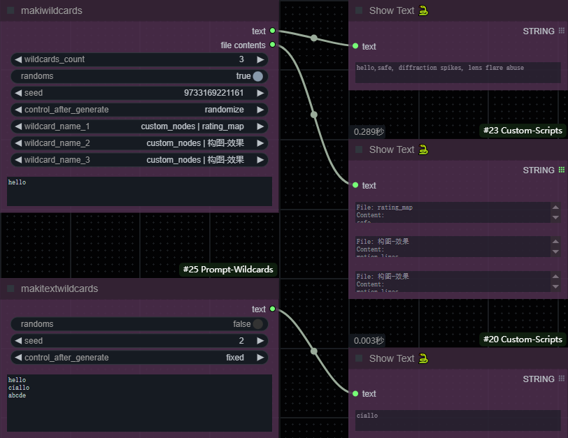
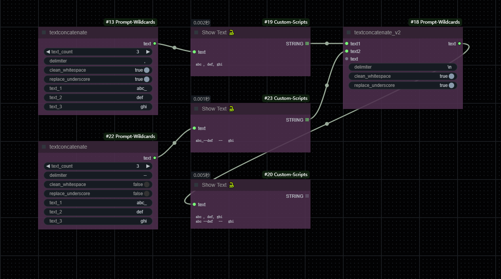

# ComfyUI-Prompt-Wildcards

ComfyUI 中通过选项使用的 Wildcards

[简体中文|[English](README.md)]

# 描述

通过选项的方式使用 Prompt Wildcards。

类似于[stable-diffusion-webui-wildcards](https://github.com/AUTOMATIC1111/stable-diffusion-webui-wildcards)在 ComfyUI 中的用处，但不使用 `__name__`。




2025/03/20: 为了保证同种子下每个不同 count 即使使用同一文件也调取不同内容，修改了 randoms 的随机方式，未来复刻时同种子将与 `2025/03/20`前的内容不同。

Wildcards 文件夹路径：

- 在 ComfyUI 安装的根目录中创建一个名为 “wildcards” 的目录（/ComfyUI/wildcards）
- 本插件目录下的“wildcards”（/ComfyUI/custom_nodes/ComfyUI-Prompt-Wildcards/wildcards）

节点参数解释：

- makiwildcards:
  - wildcards_count:选择使用的 wildcard 数量
  - randoms:是否保持种子随机，调整为 false 时按照种子的数值选择行数，true 是为了复刻原先内容（2025/1/8 前未添加该参数），即随机行
  - seed:随机种子，根据 `randoms`的模式选择 txt 文件中的某行
  - wildcard*name*{n}:选择 wildcard 文件
  - text:这里的内容将会添加到 wildcards 前面并以英文逗号相隔
- makitextwildcards:
  - `randoms`,`seed`与 `makiwildcards`中的用法均相同，`text`为需要随机的文本内容，根据 `randoms`与 `seed`选取某行文本输出，即与 wildcards 使用的 txt 中的内容同性质
- textconcatenate
  - text_count:选择使用的 text 数量
  - delimiter:间隔符
  - clean_whitespace:移除两端空白字符
  - replace_underscors:将下划线替换为空格
  - text\_{n}:文本内容

## 安装

打开 `ComfyUI`根目录下的 `custom_nodes`：

```
git clone https://github.com/MakkiShizu/ComfyUI-Prompt-Wildcards.git
```

节点名称：

- utils/Prompt-Wildcards/makiwildcards
- utils/Prompt-Wildcards/makitextwildcards
- utils/Prompt-Wildcards/textconcatenate
- utils/Prompt-Wildcards/textconcatenate_v2
- utils/Prompt-Wildcards/makiwildcards_Advanced

### 许可证

本项目遵循 MIT 许可证。

<hr>
